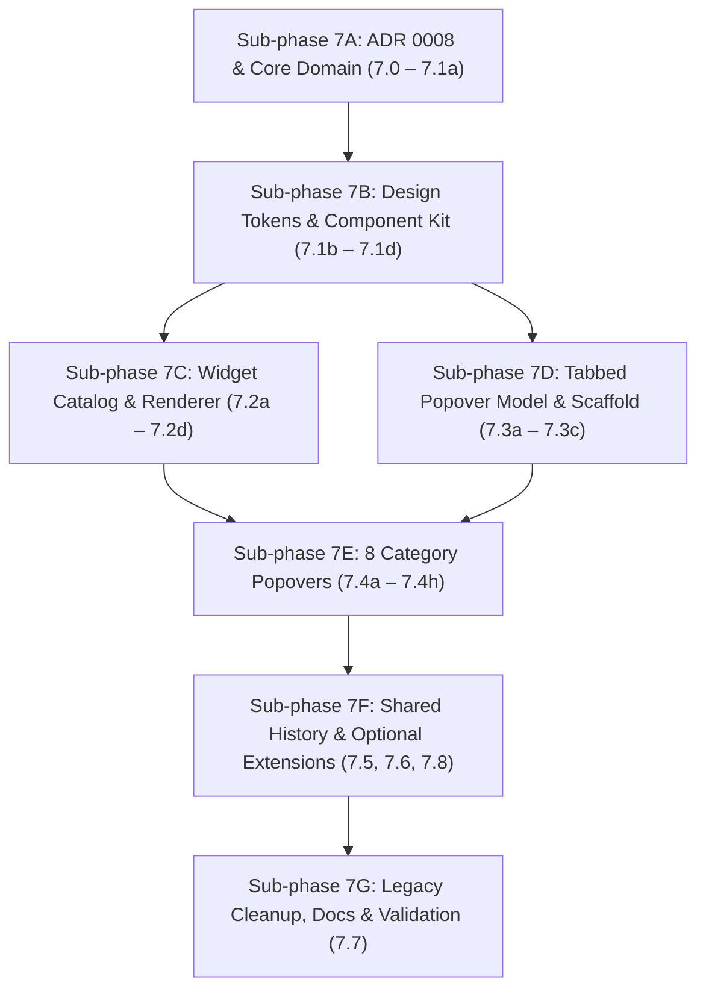

# Phase 7 — Widget & Popover Redesign — Design

The architectural and UI design slice for Phase 7. See [`plan.md`](./plan.md) for the complete specification tables and [`docs/specs/design.md`](../../specs/design.md) for the master system architecture.

---

## 1. Sub-phase Architecture Overview

To keep the build compiling and all tests green after every commit, Phase 7 is divided into **7 incremental sub-phases (7A–7G)**:

---

## 2. Core Domain Additions (`Sources/iStatsCore/`)

1. **`MetricCategory.symbolName` (`MetricCategory.swift`)**
   - Canonical SF Symbol per category (`cpu`, `memorychip`, `square.3.layers.3d`, `thermometer.medium`, `fan`, `arrow.up.arrow.down`, `internaldrive`, `battery.100percent.bolt` / `powerplug.fill`).
2. **`MetricSource` & `ThermalSensorClassifier` (`ThermalSensorClassifier.swift`)**
   - `MetricSource: String, Codable, CaseIterable, Sendable` (`peak`, `cpu`, `gpu`, `memory`, `ssd`, `battery`).
   - Pure classifier mapping `SensorReading` names/keys to `MetricSource`, replacing the UI-layer `ThermalSubsystem`.
3. **`StatusThresholds` (`StatusThresholds.swift`)**
   - Single pure threshold table for CPU, Memory pressure, GPU, Temperature (per `MetricSource`), Fan (% of max RPM), Disk (% used), and Battery charge/deficit.
   - Evaluates raw readings into semantic severity levels consumed by `MenuBarIconRenderer`, `VerdictEvaluator`, `AlertEvaluator`, and popover views.
4. **`PopoverTab` & `PopoverConfig` (`PopoverConfig.swift`)**
   - `PopoverTab` (`.overview`, `.detail`, `.history`) with per-category detail tab titles (`Cores`, `Pressure`, `Engines`, `Sensors`, `Connection`, `Volumes`, `Health`).
   - `PopoverConfig(openingTab:rememberLastTab:focusSource:)` with custom `Codable` decoder migrating all 33 legacy `PopoverStyle` strings.
5. **Widget Catalog & Migration (`MenuBarItemConfig.swift`)**
   - Adds `.glyph` style, optional `source: MetricSource?`, optional `throughputLayout`, and `showVerticalLabel: Bool`.
   - Deterministic `id` (`category.style[.source]`) and decode-time migration + order-preserving deduplication across `PreferencesStore`.

---

## 3. Presentation Design System (`iStats/UI/Design/`)

- **`Tokens.swift`**: Spacing scale (`4, 8, 12, 16`), corner radii (`6, 10`), typography scale (`11, 13, 28` monospaced rounded hero), and `Tokens.cardFill` (`.quaternary` fill + `0.5 pt` hairline border).
- **`CategoryPalette.swift`**: Canonical category identity colours (`blue`, `mint`, `purple`, `orange`, `cyan`, `indigo`, `teal`, `pink`) and two-channel chart series colours. Never used for severity.
- **`Components/`**:
  - `PopoverScaffold`: `NSVisualEffectView(.popover)` backdrop, fixed `330 pt` width, `≤ 480 pt` height, `⌘1`–`⌘3` tab shortcuts, `Esc` dismissal, shared Loading / Unavailable / Paused states, and category context footer.
  - `PopoverHeader`, `TabBar`, `HeroMetric`, `TrendChart`, `SegmentedBar`, `LegendRow`, `StatRow`, `StatGrid`, `RangeBar`, `StatusBanner`, `SkeletonView`, `CopyableValue`.

---

## 4. Tabbed Category Popovers (`iStats/UI/Popovers/`)

Each category has one root view hosted via `PopoverFactory`:
- `CPUPopover` (`Overview · Cores · History`)
- `MemoryPopover` (`Overview · Pressure · History`)
- `GPUPopover` (`Overview · Engines · History`)
- `TemperaturePopover` (`Overview · Sensors · History`)
- `FanPopover` (`Overview · History`)
- `NetworkPopover` (`Overview · Connection · History`)
- `DiskPopover` (`Overview · Volumes · History`)
- `PowerPopover` (`Overview · Health · History`, or `Overview · History` on desktops)
- `HistoryTab` (shared history template with `1m | 5m | 15m` range selector and Min/Avg/Max/Now strip)

