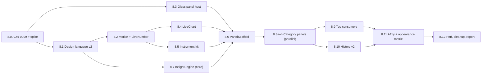

# Phase 8 — Premium Panel Redesign ("Instrument") — Master Plan

> **Status:** planned, not started. Status lives only in [`docs/progress.md`](../../progress.md).
> **Supersedes (visually):** the Phase 7 popover *presentation* layer. Phase 7's data model (`PopoverTab`, `PopoverConfig`, `MetricVerdict` thresholds, `TrendChartMath`, `Downsampler`, scalar history) is **kept** and built on.
> **Scope:** the 8 category popovers + their shell. Menu bar widget *glyphs* are out of scope except where the palette change touches `CategoryPalette.nsColor`.

---

## 1. Why Phase 7 still reads as "AI-generated"

This diagnosis comes from reading the code (`iStats/UI/Design/**`, `iStats/UI/Popovers/**`). No screenshots were used.

| # | Symptom in code | Why it reads as generic / template |
|---|-----------------|------------------------------------|
| 1 | Every popover is the same stack: `PopoverHeader` (icon chip + title + sentence + pill) → `TabBar` → `Divider` → `HeroMetric` + small `TrendChart` → `SegmentedBar` → `LegendRow`s → `Divider` → `StatRow`s → `Divider` → `PopoverFooter`. | One template filled 8 times. Nothing about CPU looks different from Disk. Premium tools give each instrument its own shape. |
| 2 | Stock system hues (`.blue`, `.mint`, `.purple`, `.red.opacity(0.70)`) and opacity ramps (`mint 100/70/45/25 %`). | Default SwiftUI colours with opacity are the clearest "assembled from defaults" signal. No tuned palette, no light/dark variants, no gradient depth. |
| 3 | A status pill on **every** popover, including a green "Fine" capsule. | Badges everywhere is dashboard-kit styling. When everything is healthy the UI should be calm. Status should only appear when it matters. |
| 4 | Typography is almost all 11 pt (`bodyLabel`, `sectionTitle`, `monoValue`). The hero is 28 pt **rounded bold**. Values use `.monospaced` *design* (SF Mono). | Flat hierarchy, and the "rounded bold numeral + mono values" combination is everywhere in generated UI. Premium Apple UI uses SF Pro with tabular digits, large light numerals, tight tracking, and tracked uppercase eyebrows. |
| 5 | Hairline-bordered cards (`cardBackground`), capsule chips, pill tab bar with an accent fill and an accent stroke. | Borders on everything, plus nested containers. Control Center and Apple's newer apps use borderless, vibrant modules and depth instead of strokes. |
| 6 | No motion besides `easeInOut(0.18)` on tab change. Numbers jump. Bars jump. Charts redraw each tick. | Static UI feels cheap. Premium monitors *breathe*: numerals roll, charts glide, meters ease. |
| 7 | Small chart (52 pt, ~180 pt wide) boxed next to the hero. | A live trace is the star of a system monitor. Here it's a thumbnail. |
| 8 | Chatty copy: `dadSentence` ("The processor is working normally", "Sampling processor telemetry..."). | Reads like generated filler. Premium copy is short, specific and numeric ("Moderate load · 3 P-cores busy"). |
| 9 | Standard `NSPopover` with an arrow, a fixed 330 pt width, and `.clipped()` content at 480 pt. | Default chrome. Clipping can cut content silently. No pin, no keyboard flow, no menu-style hover switching between items. |
| 10 | Footer with an "Activity Monitor" link plus pause and gear buttons on every popover. | Utility chrome uses vertical space without adding value. |
| 11 | Repeated `Divider()` between every section. | Lines used as layout. Spacing and grouping should do that job. |

**What's already good (keep):** real-data-only discipline, the verdict/threshold table, scalar history with spike-preserving downsampling, `⌘1–⌘3`, last-tab memory, unavailable/paused states, preview coverage.

---

## 2. North star

> **"A precision instrument, not a dashboard."**
> Opening iStats should feel like picking up a well-made tool: calm when the Mac is healthy, precise when you look closer, alive while it's open. Every panel has a **signature visual** that only makes sense for that metric.

### Design principles (these settle any disagreement)

1. **Quiet when healthy.** No "Fine" badges. Status colour only appears at `.elevated` or worse, and grows louder with severity.
2. **The trace is the hero.** A full-bleed live chart sits under the display numeral, edge to edge.
3. **One signature per instrument.** CPU core map, memory pressure arc, thermal spectrum, spinning fan, network waveform, storage bar, power flow. No two panels share a hero layout below the glance header.
4. **Motion means change.** Numbers roll, bars ease, charts glide at the sample cadence. No decorative loops. Everything honours Reduce Motion.
5. **Depth, not lines.** Vibrancy, glass, elevation and spacing replace borders and dividers.
6. **Progressive disclosure.** The glance answers *is it OK?* in 0.5 s. Hover reveals exact values. The Detail page explains *why*. History shows *since when*.
7. **Specific copy.** Short, numeric, factual. Every sentence must come from real fields.
8. **Real data only** (carried over from ADR 0008). No synthetic illustrations or placeholder constants.

---

## 3. Signature features (what makes it feel premium)

| # | Feature | Where | Task |
|---|---------|-------|------|
| F1 | **Custom glass panel** replaces `NSPopover`: no arrow, 16 pt continuous corners, Liquid Glass on macOS 26+ / vibrant material on 13–15, spring-in from the status item | Shell | 8.3 |
| F2 | **Menu-style tracking**: while one panel is open, moving the pointer over another iStats item swaps panels instantly, like system menus | Shell | 8.3 |
| F3 | **Pin & detach**: pin a panel to keep it floating as a movable mini-window | Shell | 8.3 |
| F4 | **Living chart**: full-bleed trace, smooth interpolation, glides between samples, pulsing live head, crosshair lens on hover, trackpad haptic snaps on peaks | All | 8.4 |
| F5 | **Rolling numerals**: tabular digits that animate per digit (`numericText`) | All | 8.2 |
| F6 | **Insight line**: one real fact from history ("Peak 92 % · 3 m ago", "Up 18 % vs 5 m avg", "Busy for 4 m") | All | 8.7 |
| F7 | **Signature instruments** (one per category, see design.md §6) | Each panel | 8.8a–h |
| F8 | **Power flow**: adapter → Mac → battery, with flow speed set by real watts | Power | 8.8h |
| F9 | **Top consumers** with app icons (background `libproc` sampler, finishes the unbuilt Task 7.8) | CPU, Memory, GPU*, Network* | 8.9 |
| F10 | **Keyboard-first**: `⌘1–3`, `←/→` pages, `Esc`, `⌘C` copies the hovered value, `⌘,` opens Preferences | Shell | 8.6 |
| F11 | **Scrubbable history**: range control, min/avg/max annotations, peak markers, "now" marker | History page | 8.10 |
| F12 | **Status ribbon**: a severity-tinted strip that only shows at `.elevated` or worse | Shell | 8.6 |

\* only where the OS exposes per-process data without elevated privilege. See 8.9.

---

## 4. Work breakdown

| Sub-phase | Tasks | Output |
|-----------|-------|--------|
| **8A Decisions & foundation** | 8.0 – 8.3 | ADR 0009, tokens v2, motion system, glass panel window |
| **8B Instrument kit** | 8.4 – 8.7 | LiveChart, meters/gauges/modules, PanelScaffold, InsightEngine |
| **8C Category panels** | 8.8a – 8.8h | 8 redesigned panels, each with a signature instrument |
| **8D Signature features** | 8.9 – 8.10 | Top consumers, History v2 |
| **8E Polish & ship** | 8.11 – 8.12 | Accessibility/appearance matrix, performance budget, legacy deletion, report |

Task index with links: [`tasks.md`](./tasks.md). Visual spec: [`design.md`](./design.md). Acceptance criteria: [`requirements.md`](./requirements.md).

---

## 5. Migration strategy (no big-bang)

1. **New code next to the old.** New kit goes in `iStats/UI/Instrument/` (tokens, kit, chart) and `iStats/UI/Panels/` (scaffold + 8 panels). Phase 7 files under `iStats/UI/Design/` and `iStats/UI/Popovers/` are untouched until 8.12.
2. **One switch.** `PanelFactory` replaces `PopoverFactory` at the `MenuBarController` call site, behind a DEBUG-only launch argument `-legacyPopovers YES` for side-by-side comparison. The argument is not persisted, so ADR 0006 is unaffected.
3. **Persisted model stays.** `PopoverTab` (`overview/detail/history`) and `PopoverConfig` keep their raw values. Panels map them to pages. No preference migration is needed.
4. **Delete in 8.12.** Remove the `Design/` components with no remaining callers, `Popovers/`, `PopoverFactory`, the `NSPopover` code paths, and the launch argument.

---

## 6. Platform & invariant guardrails

- **Deployment target stays macOS 13.** Every newer API sits behind `if #available`:
  - macOS 14: `contentTransition(.numericText(value:))`, `symbolEffect`, `sensoryFeedback`, `phaseAnimator`.
  - macOS 26: `glassEffect`, `GlassEffectContainer`. **8.0 must confirm availability against the installed Xcode SDK before 8.3 depends on it.**
  - Fallbacks: crossfade numerals, `NSVisualEffectView(.popover/.hudWindow)` material, `NSHapticFeedbackManager` for haptics.
- **No main-thread OS calls (ADR 0002).** Panels only read `MetricsCoordinator` published state. The new top-processes sampler (8.9) runs on scheduler-owned background work.
- **No telemetry persistence (ADR 0006).** Insights and per-core micro-history stay in memory only.
- **Degrade, don't crash.** Every instrument has an `.unavailable(reason:)` rendering (design.md §7).
- **Energy.** Animation timelines run only while a panel is visible, and pause under Low Power Mode and Reduce Motion (budget in requirements.md R8.6).

---

## 7. Risks

| Risk | Impact | Mitigation |
|------|--------|-----------|
| Custom `NSPanel` focus/dismiss edge cases (Spaces, full-screen apps, multiple displays, Stage Manager) | High | 8.3 has an explicit edge-case test matrix. Placement math is pure and unit-tested. DEBUG legacy switch stays until 8.12. |
| Liquid Glass API differences between SDKs | Med | Gated behind `#available`. Material fallback is the default path on 13–15 and must look finished by itself. |
| Continuous chart animation costs CPU | Med | Only animate while visible. Canvas drawing. Budget measured in 8.12; on breach, fall back to per-tick easing. |
| Per-process data needs privileges for other users' processes | Med | Show only processes readable without privilege. Label the section "Your apps". No elevation (ADR 0004/0005). |
| Scope creep: 8 bespoke panels | Med | Kit-first (8.4–8.6). Panels compose the kit. Each panel task has a fixed blueprint in design.md §6. |
| Palette change affects menu bar widgets | Low | `CategoryPalette` API unchanged. Values come from the new asset colours. Widget colours are reviewed in 8.11. |

---

## 8. Decisions to settle in 8.0 (defaults proposed)

| # | Question | Proposed default |
|---|----------|------------------|
| D1 | Panel width | **352 pt** (16 pt gutters → 320 pt content, 8 pt grid) |
| D2 | Max panel height before the Detail page scrolls | **560 pt**. One scroll region allowed on Detail/History only. Overview never scrolls. |
| D3 | Keep three pages or use a single scroll | **Keep 3 pages** (persisted model). Restyle as an icon page switcher in the header. |
| D4 | Category palette | Tuned palette in design.md §3.2 (Power → green, Disk → rose, uploads → coral) |
| D5 | Liquid Glass on macOS 26+ | **Yes**, gated |
| D6 | Pin/detach in v1 of the phase | **Yes** (F3) |
| D7 | Top consumers | **Yes** for CPU/Memory. GPU/Network only if a privilege-free source exists |
| D8 | Remove the footer entirely | **Yes**. Actions move to the header `⋯` menu |

