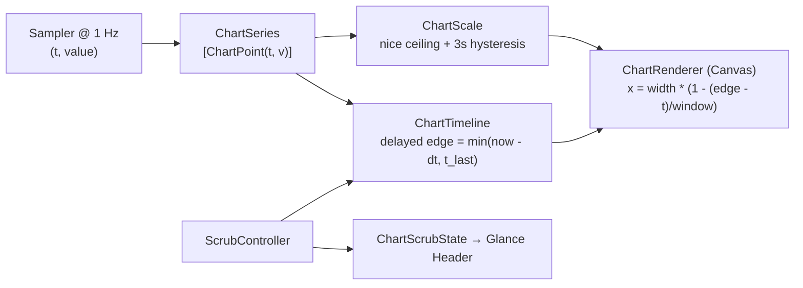

# Phase 8.5 — Design Specification ("Instrument 2" Polish)

Canonical visual, mathematical, and motion specification for Phase 8.5 (`ADR 0010`). Refines [`docs/phases/phase-08-premium-redesign/design.md`](../phase-08-premium-redesign/design.md).

---

## 1. Time-Domain Chart Engine (`LiveChart` v3)



### 1.1 Coordinate Projection & One-Sample Delayed Edge (`ChartTimeline`)
- **Model Input:** `ChartPoint(timestamp: TimeInterval, value: Double)` (or `(primary, secondary)` for stacked/mirrored and `BucketPoint(timestamp, min, max, mean)` for extended history).
- **Delayed Edge Follower:**
  - Target right edge: `targetEdge = min(now - sampleInterval, latestSampleTimestamp)`.
  - State update per frame (`dt`):
    - If `isScrubbing`: `edge` is frozen at the exact timestamp when hover began.
    - Else if `abs(targetEdge - edge) > 3.0 * sampleInterval`: `edge = targetEdge` (instant snap after wake from sleep or long pause).
    - Else: `edge` advances toward `targetEdge` at `1.0 s/s` (with a `250 ms` ease-out catch-up when releasing scrub).
- **Screen X Mapping:**
  $$x(t) = \text{plotWidth} \cdot \left(1.0 - \frac{\text{edge} - t}{\text{windowDuration}}\right)$$
  Points with $t > \text{edge}$ (the single newest point in transit) remain part of the Fritsch–Carlson monotone cubic spline calculation so the curve crossing $x = \text{plotWidth}$ has the exact tangent toward the incoming sample, clipped cleanly at `plotWidth`.
- **Head Bead:** Evaluated at $t = \text{edge}$ along the cubic segment spanning `edge`. Drawn as a `6 pt` solid circle in the series tint with a `2 pt` `Instrument.Surface.panel` cutout stroke. No continuous pulse loop.

### 1.2 Adaptive Y-Axis Scale with Hysteresis (`ChartScale`)
- **Nice Ladder:** Given raw range `[floorVal, visibleMax]`, `rawSpan = max(minSpan, (visibleMax - floorVal) * 1.10)`. Step size is chosen from $\{1, 2, 2.5, 5\} \times 10^k$ so `ceiling = floorVal + 3 * step` generates 3 clean grid intervals.
- **Asymmetric Dynamics:**
  - When `targetCeiling > displayedCeiling`: spring immediately (`response: 0.35, dampingFraction: 1.0`).
  - When `targetCeiling < displayedCeiling * 0.70`: increment `belowThresholdDuration += dt`. Once `belowThresholdDuration >= 3.0 s`, ease `displayedCeiling` down toward `targetCeiling` (`duration: 0.60 s`).
- **Domain Floors:**
  - `.cpu`, `.memory`, `.gpu`: fixed `0.0 ... 100.0`.
  - `.thermal`: dynamic floor `max(20.0, floor((visibleMin - 5.0) / 10.0) * 10.0)` (in Celsius, converted for display).
  - `.fan`: floor at `Double(fan.minRPM ?? 0)`, ceiling at `max(Double(fan.maxRPM ?? 6000), visibleMax * 1.1)`.
  - `.network`, `.disk`, `.power`: floor `0.0`, adaptive nice ceiling.
- **Independent Mirrored Scales (`.mirrored`):**
  - Top half (`0 ... midY`) uses `topScale: ChartScale` (Download `↓` / Read `R`).
  - Bottom half (`midY ... height`) uses `bottomScale: ChartScale` (Upload `↑` / Write `W`).
  - Left gutter displays `↓ <topCeiling>` at `y = 2` and `↑ <bottomCeiling>` at `y = height - 11` in `9.5 pt` tertiary tabular text.

### 1.3 Time-Aligned Extended History Envelopes (`Downsampler.alignedBuckets`)
- For window duration $W \in \{300\text{ s}, 900\text{ s}\}$ and target bucket count $N = 120$:
  - Bucket width $\Delta t = W / N$ ($2.5\text{ s}$ for 5m, $7.5\text{ s}$ for 15m).
  - Each `ScalarPoint(timestamp, value)` maps to `bucketID = Int(floor(timestamp / deltaT))`.
  - Within each `bucketID`, compute `BucketPoint(timestamp: (Double(bucketID) + 0.5) * deltaT, min: minVal, max: maxVal, mean: sum / count)`.
- **Rendering:**
  - When `bucket.max - bucket.min > 0.02 * scaleSpan`, draw a continuous upper/lower spline polygon filled with `tint.opacity(0.14)` (`min...max` envelope), overlaid with a `1.75 pt` stroke along `bucket.mean`.

### 1.4 Visual & Scrubbing Specification
- **Stroke & Glow:** `1.75 pt` round-joined stroke. In Dark Mode (when Increase Contrast is off), draw an underlay path (`lineWidth: 5.0`, `tint.opacity(0.16)`, `blur(radius: 3.0)`).
- **Area Fill:** Linear gradient from `tint.opacity(0.20)` at the curve top to `.clear` at `85%` of plot height. Leading `20 pt` horizontal alpha ramp fades the oldest edge into the glass surface.
- **Grid & Axes:** 3 solid `0.5 pt` hairlines (`Color.primary.opacity(0.06)`). Value labels (`9.5 pt` tertiary tabular) sit in the **left** gutter `2 pt` above each line, keeping the right live head completely unobstructed. History adds a bottom time axis (`-15m`, `-10m`, `-5m`, `now`).
- **Threshold Zone Shading (Memory & Thermal):** Subtle `3%` tint wash above warning/critical thresholds, plus a vertical linear gradient on the stroke itself so segments crossing above the warning/critical y-coordinate turn amber/red.
- **Stocks-Style Header Scrub:**
  - Hovering sets `ChartScrubState(isActive: true, primaryValue: ..., secondaryValue: ..., timestamp: ..., relativeSeconds: ...)`.
  - `PanelScaffold` swaps the Glance display numeral to the scrubbed value and the headline to `"<relative> · <HH:mm:ss>"`.
  - Crosshair is a `1 pt` vertical line with top/bottom `6 pt` alpha fades and a `6 pt` snapped bead on each active series, horizontally spring-filtered (`0.12 s`).

---

## 2. Panel Shell & Motion v2

```
┌────────────────────────────────────────────┐
│ (●) CPU            Now  Details  History  ⋯ │  ← 18pt tinted badge + 13pt semibold title + text puck switcher
│                                            │
│ 42%                          ● Elevated    │  ← 40pt light numeral + inline status pill
│ Moderate load · 10 cores · 3.2 GHz         │  ← 12.5pt secondary (scrub: "12s ago · 14:02:31")
│ ░░░░░░░░░░░░░░░░░░▁▂▃▅▆▅▃▂▁▂▃▄▅▆▇▆●        │  ← 84pt full-bleed hero chart, left fade + dark bloom
│ ↗ Peaked 92% 40s ago                       │  ← dedicated 11pt insight line below chart
│ ┌────────────────────────────────────────┐ │
│ │ Cores                    Load 2.31     │ │  ← Section v2: sentence-case header INSIDE card
│ │ ...                                    │ │
│ └────────────────────────────────────────┘ │
└────────────────────────────────────────────┘
```

- **Persistent Hosting View:** `MetricPanel` initializes `PanelBackgroundView` and `NSHostingView<AnyView>` once. `updateRootView(_:)` updates `hostingView.rootView` in place without rebuilding AppKit layers.
- **Synchronized Top-Anchored Height Morph:**
  - `PanelScaffold` measures its inner `VStack` via `PanelContentHeightKey: PreferenceKey` and pins content with `frame(maxHeight: .infinity, alignment: .top)`.
  - `PanelController` animates `panel.animator().setFrame(targetFrame, display: true)` with duration `0.32 s` and `CAMediaTimingFunction(controlPoints: 0.2, 0.9, 0.25, 1.0)` matching `Motion.snappy`.
  - Open transition animates content layer `opacity (0 → 1)`, `scale (0.96 → 1.0, anchor: .top)`, and `yOffset (-6 → 0)`.

---

## 3. Kit v2 & Secondary Series Palette

### 3.1 Secondary Series Hues (`PaletteContrast.Hex`)
| Series | Light Hex | Dark Hex | Usage |
|--------|-----------|----------|-------|
| `cpuSystem` | `#D9483B` | `#FF6B5E` | CPU System stacked series & composition |
| `cpuEfficiency` | `#0C8AB8` | `#38BDF8` | E-Core cluster bars (distinct from Fan category) |
| `memoryWired` | `#0B7A5E` | `#20A884` | Memory composition Wired segment |
| `memoryCompressed` | `#6D4AFF` | `#9B82FF` | Memory composition Compressed segment |
| `memoryCached` | `#2B7A9B` | `#58B4D8` | Memory composition Cached segment |
| `networkUpload` | `#7C3AED` | `#A78BFA` | Network Upload mirrored bottom series |
| `diskWrite` | `#D97706` | `#FBBF24` | Disk Write mirrored bottom series |

### 3.2 Primitives
- **`Section` (Module v2):** Integrated header row (`11.5 pt` `.semibold` secondary sentence-case title + trailing view) separated from body content by `8 pt`. Maximum **3 sections per page**.
- **`MetricRow` Table Style:** `26 pt` row height, `0.5 pt` `Color.primary.opacity(0.06)` divider between rows, hover highlight only when `isCopyable` or interactive, revealing a `doc.on.doc` micro icon on hover.
- **`SegmentedControl` & `FilterChip`:** One glass-puck `SegmentedControl` (used by `PageSwitcher` and History's `1m · 5m · 15m` selector) and one capsule `FilterChip` (used by channel isolation and thermal source chips).

---

## 4. Per-Panel Instrument 2 Redesign

| Category | Now Page (Max 3 Sections) | Details Page | History Page |
|----------|---------------------------|--------------|--------------|
| **CPU** | 1. **Cores** (`10×36 pt` P/E cluster columns with `cpuEfficiency` hue, live hover header readout)<br>2. **Top Apps** (animated rank reordering) | 1. **Load Average Dot Plot** (`1m · 5m · 15m` markers plotted along a horizontal scale with a vertical core-count capacity tick)<br>2. **Composition** (User / System / Idle split capsule)<br>3. **Per-Core Grid** (2-column compact sparkline + % tiles; uptime in trailing header) | Stacked User + System, `FilterChip` channel isolation |
| **Memory** | 1. **Memory Allocation** (5-segment `SplitCapsule` hero + 2-column legend with `swatch · label · bytes · %` + **3-step Pressure Segmented Pill** `Normal · Warning · Critical` + Swap/Compressed callouts — **fake `ArcGauge` removed**)<br>2. **Top Apps** | 1. **Swap Allocation** (`Meter` + used/total/free)<br>2. **Virtual Memory Pages** (table rows with 0.5 pt hairlines — **duplicate banded chart removed**) | Threshold-shaded single trace (`60%` / `80%` zones) |
| **GPU** | 1. **Engine Activity** (`RingStack` + right-aligned tabular legend with % bars)<br>2. **VRAM & Working Set** (combined section) | 1. **Engine Breakdown** (Device / Renderer / Tiler meters)<br>2. **Architecture Spec Sheet** (2-column key/value grid) | Single utilization trace (`0–100%`) |
| **Thermal** | 1. **Thermal Spectrum (`30°–110°C`)** (8 pt ramp with `10°` ticks, non-overlapping sensor pins, **merged** with ranked subsystem group bars directly below) | **Collapsible Sensor Groups** (`DisclosureGroup`-style tables per subsystem, top group expanded by default) | Domain-floored trace, threshold shading, subsystem `FilterChip`s |
| **Fan** | 1. **Cooling Channels** (RPM-locked calm turbine + **Min–Max RPM Range Bar** with live position marker per fan, replacing `ArcGauge` dials)<br>2. **Acoustics & Control** | **Cooling Hardware** (min/max/target RPM & mode table; passive cooling empty state on fanless Macs) | Domain-floored RPM trace (`minRPM` floor) |
| **Network** | 1. **Active Link** (interface badge, SSID, `SignalBarsView`, copyable IP + inline session totals `↓ Total` / `↑ Total`)<br>2. **Routing & DNS** (compact copyable table) | 1. **Interfaces** (ranked list with live `↓/↑` rates)<br>2. **Wi-Fi Radio Telemetry** (RSSI, Noise, SNR, Tx rate, channel) | Independent-scale mirrored waveform + min/max envelope |
| **Disk** | 1. **Boot Volume Storage** (`14 pt` `SplitCapsule` + 2-column legend)<br>2. **Live Throughput & IOPS** (Read/Write rates + IOPS counters) | **Mounted Volumes** (each volume with a thin capacity bar, filesystem badge, and used/free/total readout) | Independent-scale mirrored R/W waveform + envelope |
| **Power** | 1. **Power Flow Topology** (calm wattage-proportional dash velocity + `BatteryGlyph` state)<br>2. **Charge & Time Remaining** (or Desktop System Draw bar) | 1. **Battery Health & Cycle Life** (`RingStack` + design vs max capacity meter)<br>2. **Electrical Diagnostics** (voltage, amperage, adapter watts, temperature) | Wattage trace with nice-number autoscale |

